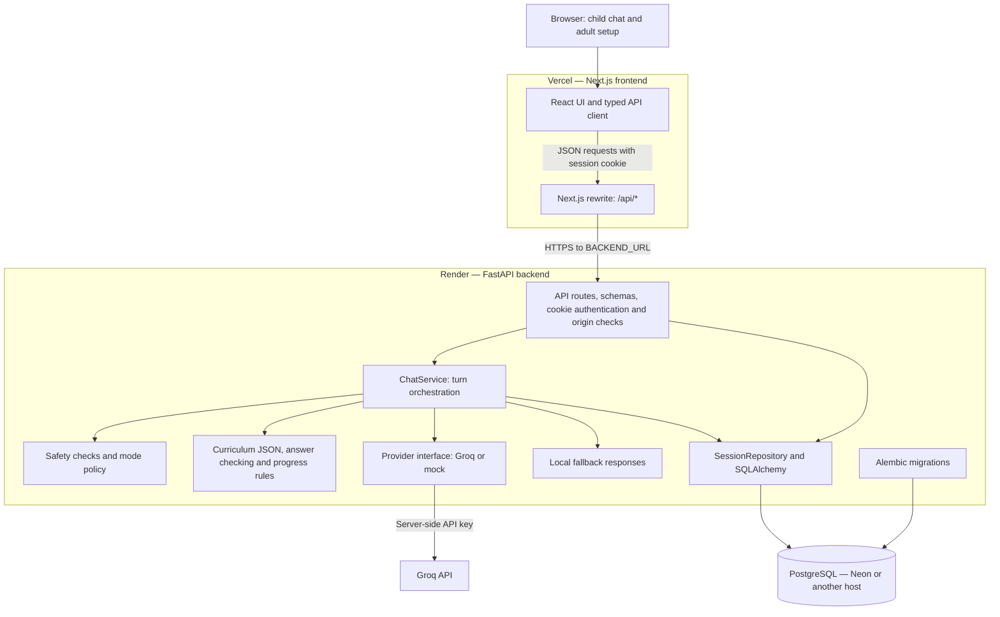
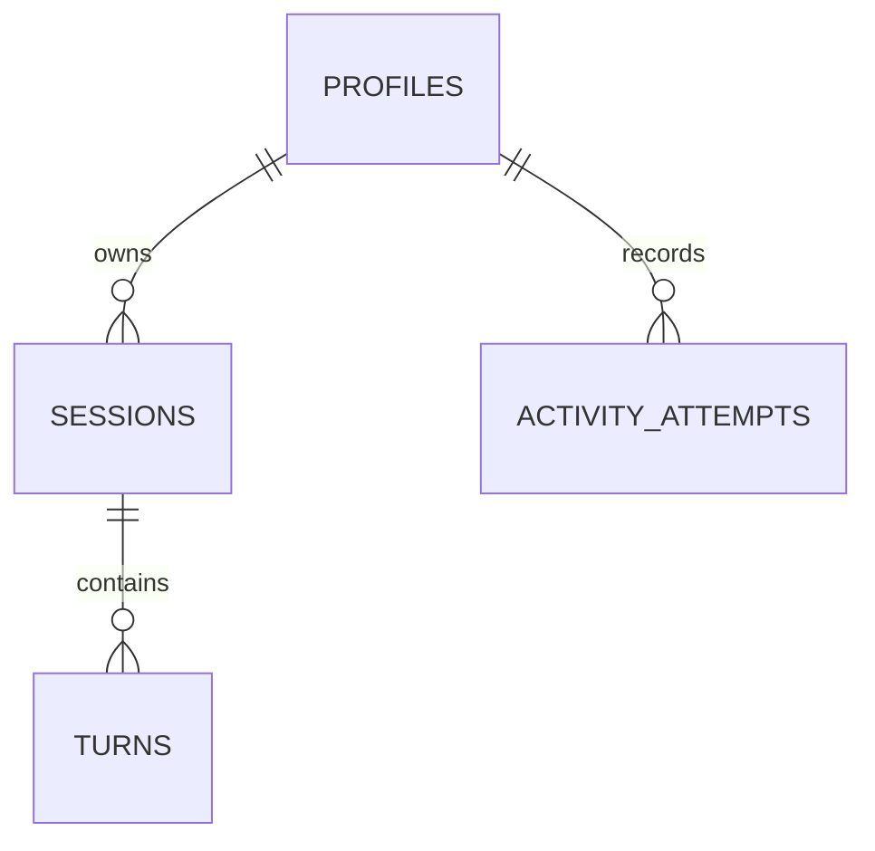

# Little English Buddy 🐥💬

> **A safe, text-only English learning chatbot for children under seven.**  
> Built with modern Python (FastAPI + SQLAlchemy async + SQLite WAL) and Next.js 16 (App Router + React 19 + Tailwind CSS v4).

[](#automated-testing)
[](#automated-testing)
[](#automated-testing)
[](#automated-testing)

---

## 1. Overview & Pedagogical Design

**Little English Buddy** is tailored specifically for early learners (ages 3–7) acquiring English as a first or additional language. 

### Core Features
- **Deterministic Mock Provider by Default**: Boots and operates with 100% functionality without requiring external cloud accounts or API keys.
- **Optional Groq LLM Support**: High-speed, child-safe inference powered by `llama-3.3-70b-versatile` with bounded word limits ($\le 20$ words) and strict safety guardrails.
- **Child-Friendly Mascot (Pip)**: A lightweight inline SVG chick with reactive moods (`idle`, `thinking`, `happy`, `encouraging`, `break`) and zero external asset dependencies.
- **Structured Curriculum (33 Activities)**: Spans 3 levels (`L1 Explorer`, `L2 Adventurer`, `L3 Champion`) across vocabulary, phonics, simple phrases, and sentence building.
- **8/10 Promotion Engine**: Unassisted correct answers trigger automatic level advancement with skill variety requirements; assistance hints are offered after 2 failed attempts without penalizing confidence.
- **5-Tier Mode Policy**: Prioritizes child well-being through an unbreakable ladder: `Safety > Distress > Explicit Action > Learning Activity > Conversation`.
- **Parental Controls & Math Gate**: Grown-ups access profile stats, curriculum level overrides, and data deletion behind an adult math verification gate ($7 + 8 = 15$).
- **Privacy & Safety Guarantees**: Comprehensive regex PII redaction (email, phone, address), zero raw HTML rendering, and HttpOnly session cookies.

---

## 2. Architecture & Technology Stack

| Component | Technology | Rationale |
| :--- | :--- | :--- |
| **Backend Framework** | FastAPI (Python 3.12+) | Async request handling, Pydantic v2 schemas, OpenAPI specs |
| **Database** | SQLite (local); PostgreSQL (deployment) | SQLAlchemy async access, relational persistence, Alembic migrations |
| **Frontend Framework** | Next.js 16.4.2 (App Router) + React 19 | Server-side rendering, fast hydration, Turbopack builds |
| **Styling** | Tailwind CSS v4 | Responsive mobile-first utility layout down to 360px viewport |
| **Testing** | Pytest, Vitest, Playwright | Multi-layer automated testing across unit, integration, and browser |

### Architecture Diagram

The deployment uses Vercel for the Next.js frontend, Render for the FastAPI
backend, and a separate PostgreSQL database for persistent records. The browser
calls the frontend's `/api` path; a Next.js rewrite forwards requests to Render.
This keeps the session cookie on the frontend domain.



Local development uses the same application layers with SQLite in WAL mode.
`LLM_PROVIDER=mock` runs without Groq. The hosted configuration is defined in
[`render.yaml`](render.yaml), [`frontend/vercel.json`](frontend/vercel.json), and
[`frontend/next.config.ts`](frontend/next.config.ts). See
[DEPLOYMENT.md](DEPLOYMENT.md) for setup instructions.

### System Design Documentation

#### Component responsibilities

| Layer | Responsibility | Main implementation |
| :--- | :--- | :--- |
| Frontend | Adult setup, optional placement, chat, activity choices, settings, and rendering the latest session state | `frontend/app/page.tsx`, `frontend/components/` |
| API client and proxy | Typed JSON requests, credentials, request IDs, error handling, and forwarding `/api` calls | `frontend/lib/api.ts`, `frontend/next.config.ts` |
| HTTP API | Validate inputs, resolve cookie sessions, check mutation origins, and expose health endpoints | `backend/app/api/routes.py`, `backend/app/schemas/api.py` |
| Chat orchestration | Check request replay and session revision, select a response path, and persist turn results | `backend/app/services/chat.py` |
| Learning rules | Resolve interaction mode, check curriculum answers, track attempts, and offer level promotion | `backend/app/services/mode_policy.py`, `backend/app/services/progress.py`, `backend/app/curriculum/` |
| Provider adapters | Generate conversational replies through Groq or the local mock and validate structured output | `backend/app/providers/` |
| Persistence | Store profiles, sessions, attempts, and turn responses through an async repository | `backend/app/db/`, `backend/migrations/` |

#### Session and API design

The application uses an opaque session credential rather than an account login.
Session creation sets an HttpOnly `eb_session` cookie; the database stores its
hash. Subsequent requests resolve that credential to a session and profile.
Production cookies use `Secure` and `SameSite=Lax`. The Vercel proxy makes API
requests same-origin from the browser's perspective, and `FRONTEND_ORIGIN`
defines the exact allowed origins for CORS and mutation checks.

| Method and endpoint | Purpose |
| :--- | :--- |
| `POST /api/session` | Create a profile and session with an optional nickname and starting level |
| `GET /api/session` | Restore level, mode, recent messages, revision, and active activity; return `401` without a valid session |
| `POST /api/chat` | Process a message or action and return the reply, activity, suggestions, source, and new revision |
| `POST /api/session/reset` | Reset the authenticated session's learning progress and chat history |
| `DELETE /api/session` | Delete the session and associated profile data, then clear the cookie |
| `GET /health` | Check that the API process responds |
| `GET /ready` | Check database connectivity and loaded configuration |

The health endpoints are accessed directly on the backend host. The frontend
rewrite forwards only `/api/*`.

#### Chat request lifecycle

```mermaid
sequenceDiagram
    participant Browser
    participant Web as Next.js proxy
    participant API as FastAPI / ChatService
    participant DB as Database
    participant Provider as Groq or mock

    Browser->>Web: POST /api/chat with request_id and expected_revision
    Web->>API: Forward JSON, cookie and origin
    API->>DB: Resolve session and look up request_id
    alt Completed request with matching input
        DB-->>API: Saved response
        API-->>Web: Return saved response
    else Conflicting input or stale revision
        API-->>Web: 409 Conflict
    else New turn
        API->>DB: Create and commit pending turn
        API->>API: Apply safety, mode and curriculum rules
        opt A generated reply is needed
            API->>Provider: Bounded conversation context
            Provider-->>API: Validated reply or provider error
            API->>API: Select local fallback on error or timeout
        end
        API->>DB: Commit response and state; advance revision
        API-->>Web: ChatResponse
    end
    Web-->>Browser: JSON response or conflict
```

Each chat request carries a UUID `request_id` and the last known
`expected_revision`. A completed request with the same input returns its saved
response. Reusing the ID with different input or submitting an outdated revision
returns `409`. The pending turn is committed first; on normal completion, the
response and learning state changes are committed together. Unexpected failures
roll back in-progress changes and mark the turn failed.

Safety checks can select a local support response before provider generation.
Curriculum answer checking and promotion eligibility are implemented in backend
code. The provider generates conversational content; it does not determine
whether an activity answer earns credit. Promotion is offered when the learning
rules are satisfied and applied after an acceptance action.

#### Data model and persistence



| Entity | Stored data and constraints |
| :--- | :--- |
| `profiles` | Nickname, level, skill progress, and promotion flags |
| `sessions` | Credential hash, expiry, mode, active activity, bounded message history, and revision |
| `activity_attempts` | Activity instance, result, assistance flag, skill, and level; unique per profile and activity instance |
| `turns` | Request ID, input fingerprint, status, revisions, and saved response; unique per session and request ID |

Curriculum content is loaded from `backend/app/curriculum/activities.json` and
validated at startup. SQLAlchemy provides async access through `aiosqlite`
locally and `asyncpg` for PostgreSQL. Alembic owns schema migrations; the Render
start command applies migrations before launching one Uvicorn worker. Hosted
PostgreSQL keeps records outside the backend service's filesystem.

#### Reliability, security, and operating limits

- The Groq client disables automatic SDK retries. Its default timeout is
  1,600 ms, while chat processing budgets provider time against a 2,400 ms
  deadline. These are application budgets, not end-to-end latency guarantees.
- Provider failures or timeouts select a local fallback, roll back pending
  learning changes, and persist the fallback turn. Responses identify their
  source as `groq`, `mock`, `curriculum`, or `fallback`.
- Provider context includes a bounded recent history (eight messages by default).
  Input redaction and output validation reduce unsafe or malformed content;
  pattern-based filtering is imperfect and is not a guarantee of safety.
- API keys and database credentials stay in backend environment variables.
  The frontend renders chat messages as text. The adult math gate is a UI
  interaction gate, not a separate authenticated adult account.
- The deployment is a single backend service with synchronous request/response
  chat. It has no background queue or response streaming. Revision and request-ID
  checks help detect replay and stale state; they do not establish verified
  correctness under arbitrary multi-worker concurrency.
- `/health`, `/ready`, application logs, and provider timing logs support
  diagnosis. Free-host cold starts and external provider/database latency can
  increase response time. Horizontal scaling requires additional concurrency
  validation and database capacity planning.

Additional design notes are available in [docs/architecture.md](docs/architecture.md).

---

## 3. Quick Start Guide

### Prerequisites
- **Python**: $\ge 3.12$ (Render configuration uses Python 3.12.10)
- **Node.js**: 24.x (as specified in `frontend/package.json`)
- **Git**

---

### Step 1: Backend Setup

```bash
# Navigate to backend directory
cd backend

# Create virtual environment
python -m venv .venv

# Activate virtual environment
# Windows (PowerShell):
.\.venv\Scripts\Activate.ps1
# Linux/macOS:
# source .venv/bin/activate

# Install dependencies
pip install -r requirements.txt

# Copy environment template
cp .env.example .env

# Apply database migrations
alembic upgrade head

# Run backend development server
uvicorn app.main:app --reload --port 8000
```
Backend will be live at `http://localhost:8000`. Health check available at `http://localhost:8000/health`.

---

### Step 2: Frontend Setup

Open a new terminal:

```bash
# Navigate to frontend directory
cd frontend

# Install dependencies
npm install

# Run frontend development server
npm run dev
```
Frontend will be live at `http://localhost:3000`.

If Next.js selects port 3001 because 3000 is occupied, include both origins in
`backend/.env`: `FRONTEND_ORIGIN=http://localhost:3000,http://localhost:3001`.
Restart the backend after changing this setting. Use `localhost` consistently
for both the frontend and API so session cookies work correctly.

---

Deployment on Render Free + Vercel Hobby: see [DEPLOYMENT.md](DEPLOYMENT.md)
for the complete setup, environment variables, and database instructions.

## 4. Configuration & Environment Variables

### Backend (`backend/.env`)

| Variable | Default | Description |
| :--- | :--- | :--- |
| `APP_ENV` | `development` | Application environment (`development` or `production`) |
| `LLM_PROVIDER` | `mock` | Active provider: `mock` (offline, default) or `groq` (cloud) |
| `GROQ_API_KEY` | `""` | Groq API key (required only if `LLM_PROVIDER=groq`) |
| `GROQ_MODEL` | `openai/gpt-oss-20b` | Settings default and Render model; environment files can override it |
| `DATABASE_URL` | SQLite file under `backend/data/english_buddy.db` | Async database connection URL; use PostgreSQL for deployment |
| `FRONTEND_ORIGIN` | `http://localhost:3000` | Comma-separated allowed CORS and CSRF origins (example env also includes port 3001) |
| `MAX_INPUT_CHARS` | `500` | Child input character ceiling |
| `PROVIDER_TIMEOUT_MS` | `1600` | Provider request timeout in milliseconds |
| `CHAT_DEADLINE_MS` | `2400` | Chat processing budget used to bound provider waiting |
| `ENABLE_LIVE_EVAL` | `false` | Enable live evaluation suite against Groq API |

### Frontend (`frontend/.env.local`)

| Variable | Default | Description |
| :--- | :--- | :--- |
| `BACKEND_URL` | `http://localhost:8000` | Server-side API proxy destination; set to Render URL on Vercel |
| `NEXT_PUBLIC_API_BASE_URL` | empty | Optional direct API override for local development; leave unset on Vercel |

---

## 5. Automated Testing & Verification

The project includes an end-to-end verification script running all 7 quality gates:

```bash
# From the repository root (with backend virtualenv active):
python scripts/verify.py --with-e2e
```

### Individual Test Commands

```bash
# Backend Linting (Ruff)
cd backend && ruff check app tests

# Backend Type Checking (Mypy strict)
cd backend && mypy app tests

# Backend Pytest Suite (53 tests)
cd backend && pytest -v

# Frontend Type Checking (TypeScript)
cd frontend && npm run type-check

# Frontend Unit Tests (Vitest, 14 tests)
cd frontend && npm test

# Frontend Production Build (Next.js)
cd frontend && npm run build

# End-to-End Browser Tests (Playwright, 4 scenarios)
cd frontend && npm run test:e2e
```

### Benchmarks & Evaluation

```bash
# Run Latency & Concurrency Benchmark (5 sessions, 100 turns):
python scripts/benchmark_latency.py --concurrency 5 --turns 100

# Run Live Groq Evaluation (40 child scenarios + safety probes):
# Requires ENABLE_LIVE_EVAL=true and GROQ_API_KEY set
python scripts/eval_live.py
```

For full test coverage matrices and benchmark statistics, see [TEST_REPORT.md](TEST_REPORT.md).

---

## 6. Child Safety & Data Governance

1. **COPPA / Child Privacy Alignment**:
   - Only an optional first name or nickname is stored for greeting personalization.
   - PII (emails, phone numbers, addresses) is sanitized via regex boundaries before LLM ingestion and logging.
   - All server logs automatically mask authorization cookies and API keys.
2. **Harm Escalation**:
   - Any safety keywords (`hurt`, `emergency`, `danger`, `scared`, `alone`) immediately trigger an adult consultation message.
3. **Data Control**:
   - Parents can review stored data, reset learning history, or completely erase profile and session cookies at any time via the Adult Settings panel.

---

## 7. License

This project is licensed under the MIT License.
# BRIMSEL-assesment

